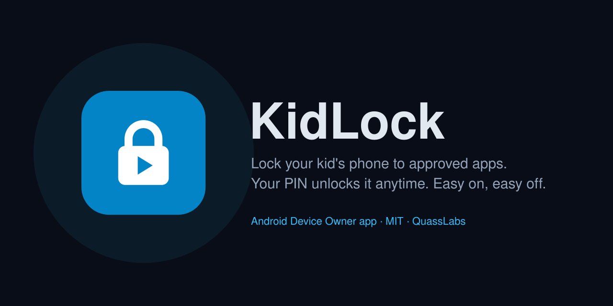

# KidLock



An Android Device Owner app that turns a spare phone into a locked-down device for a child. It does two jobs:

1. **Pins approved apps** (any installed app you tick, such as YouTube Kids or Netflix) in lock task mode, so the child cannot leave the app. A PIN-protected **Done** button ends the session.
2. **Takes away the phone part of the phone**, in **Total lockdown** mode: no calls, no texts, no SIM. Wi-Fi keeps working, because the streaming apps need it.

Kotlin, standard Views, `androidx.appcompat` only. No network code, no analytics. minSdk 26, targetSdk 34.

## Two modes

KidLock ships with **Total lockdown** as the default. **Light** is one tap away in Parent settings. If neither fits, there is also a no-install option below.

| | Total lockdown (default) | Light |
|---|---|---|
| Pinned app sessions with PIN exit | Yes | Yes |
| Factory reset, safe mode, new users, clock changes | Blocked | Blocked |
| Developer options and USB debugging | Blocked (switchable) | Blocked (switchable) |
| Outgoing calls | Blocked | Allowed |
| Text messages | Blocked | Allowed |
| SIM cards and eSIM (Android 15+) | Blocked | Allowed |
| Mobile network settings | Locked | Allowed |
| Emergency calls | Still work | Still work |

### Total lockdown

**What it is:** the phone becomes a streaming device, not a phone. Best for a spare phone handed to a young child for shows in the car, on a plane, or at bedtime.

**Requirements**
- Device Owner setup: a computer with ADB, and a few minutes with every account signed out. No factory reset needed on most phones; you sign back in afterwards. See [Setup](#setup).
- Wi-Fi, since that is the only connection the streaming apps will have.
- Pull the SIM.

**Limitations**
- SIM blocking needs Android 15+. On older phones, calls and texts are still blocked with a SIM inserted, but mobile data would work, so pull the SIM.
- Emergency calls always work. No app can block them.
- Between sessions the child can open other installed apps and most of Settings. Uninstall what you do not want reachable.
- A forced reboot (holding the power button) ends a session. The restrictions survive it; the pinned session does not.

### Light

**What it is:** the phone stays a working phone, with screen-time sessions on top. Best for an older child who needs to reach family, on a phone you still want protected from being wiped.

**Requirements**
- The same Device Owner setup as Total lockdown. Light is a setting, not a lighter install.
- The SIM stays in.

**Limitations**
- Calls, texts, and mobile data all work outside a session.
- Airplane mode is up to the child. You can switch it on, but they can switch it off; Android has no way to lock it on (see [Why not airplane mode?](#why-not-airplane-mode)).
- Emergency calls, other apps between sessions, and forced reboots behave the same as in Total lockdown.

### Lighter than Light: no KidLock at all

**What it is:** Android's built-in **App pinning** (Settings > Security > App pinning). It keeps the child in one app until it is unpinned.

**Requirements:** none. No computer, no reset, about a minute to turn on.

**Limitations**
- The child sees a "pin this app?" prompt each time.
- Unpinning uses the phone's own lock screen PIN, not a separate parent PIN.
- Nothing else is restricted: no call or text blocking, and no protection against a factory reset.

This is the right choice if all you want is "stay in this one app for a while."

### Fine-tuning

- **USB debugging:** **Block developer options** in Parent settings is on by default in both modes. Turn it off to install updates.
- **Fewer protections:** the anti-tamper set lives in `BASE_RESTRICTIONS` in `KidLockApp.kt`. Removing entries is possible, but without the factory reset block the child can wipe the phone and remove KidLock entirely.

## Why not airplane mode?

Locking airplane mode ON was the original idea. Android cannot do it: the only related Device Owner control, `DISALLOW_AIRPLANE_MODE`, **forces airplane mode off** and keeps it off. We confirmed this on Android 16, where applying it switched the cellular radio back on in the same instant. No public API lets an app turn airplane mode on. Blocking calls, texts, and SIMs reaches the same goal and leaves Wi-Fi alone.

## Build

```bash
./gradlew assembleDebug
```

The APK lands at `app/build/outputs/apk/debug/app-debug.apk`. Android Studio can also open the folder directly.

## Setup

### Before you start: sign out, then sign back in

Android only lets an app become Device Owner while **no accounts are signed in** on the phone. That rule applies only at the moment you run the setup command, so this is a temporary sign-out, not a wipe:

1. **Sign out.** Go to Settings > Accounts (sometimes "Passwords & accounts") and remove every account: Google, Samsung, email, and so on. Your apps, photos, and files stay on the phone.
2. **Delete any extra users.** If the phone has a second user or a guest profile, remove it under Settings > System > Users. Only the main user can remain.
3. **Run the setup below.**
4. **Sign back in.** Add your accounts again under Settings > Accounts, or sign in inside the streaming apps. KidLock does not block this.

**When you do need a factory reset:** only if an account refuses to be removed. Some carrier or manufacturer accounts are locked in. On those phones, factory reset, skip every sign-in screen during setup, run the steps below, then sign in. A freshly reset spare phone is also the easiest start if you have one, but it is not required.

### Steps

1. Enable Developer options and USB debugging on the phone, then install the APK:
   ```bash
   adb install app/build/outputs/apk/debug/app-debug.apk
   ```
2. Make KidLock the Device Owner:
   ```bash
   adb shell dpm set-device-owner com.quasslabs.kidlock/.AdminReceiver
   ```
3. Connect the phone to your Wi-Fi.
4. Open KidLock, pick a mode, tick the allowed apps (the search box filters the list), set a PIN, and tap **Apply**. With **Block developer options** on (the default), ADB disconnects the moment you tap Apply. That is intended: it stops anyone from reconfiguring the phone over USB.
5. For Total lockdown, pull the SIM card.
6. Hand it over.

To install an update later: enter **Parent settings**, turn off **Block developer options**, tap **Apply**, re-enable USB debugging, and run `adb install -r` with the new APK. Updates must be signed with the same key as the installed build, so build them on the same computer or set up a release signing key.

## Daily use

- Open KidLock: it shows a button for each allowed app, with a search box to find one quickly.
- Tapping one starts a locked session. Home, Recents, and the power menu are disabled; the child stays in that app.
- Backing out of the app lands on the KidLock lock screen, with **Back to app** and **Done ✓**.
- **Done ✓** asks for the PIN, then ends the session.
- **Parent settings** on the main screen also asks for the PIN.
- After 5 wrong PINs, entry locks for 30 seconds, doubling with each further miss up to an hour.

## How it works

| Piece | What it does |
|---|---|
| `AdminReceiver` | The `DeviceAdminReceiver` that becomes Device Owner. No logic. |
| `KidLockApp.kt` | Application class plus the `KidLock` helper: the list of installed apps, the two restriction sets, and salted SHA-256 PIN storage with lockout in SharedPreferences. |
| `MainActivity` | Shows the ADB command if not Device Owner, otherwise the kid launcher or the PIN-gated parent settings. |
| `LockActivity` | Root of every locked session. Declared `lockTaskMode="if_whitelisted"` and `singleInstance`, so it enters lock task mode on launch, then starts the chosen app on top of itself. |
| `BootReceiver` | Re-applies the saved policy after a reboot. Device Owner policy already persists; this is a safety net. |

Policy calls:

- App allowlist: `setLockTaskPackages(admin, selected apps + KidLock itself)`
- No power menu, Home, or Recents in a session: `setLockTaskFeatures(admin, LOCK_TASK_FEATURE_NONE)`, called after `setLockTaskPackages` because on Android 14+ that call resets the features
- Both modes: `DISALLOW_FACTORY_RESET`, `DISALLOW_SAFE_BOOT`, `DISALLOW_ADD_USER`, `DISALLOW_CONFIG_DATE_TIME` (the PIN lockout relies on the clock)
- Total lockdown adds: `DISALLOW_OUTGOING_CALLS`, `DISALLOW_SMS`, `DISALLOW_CONFIG_MOBILE_NETWORKS`, and `DISALLOW_SIM_GLOBALLY` on Android 15+
- On by default, switchable: `DISALLOW_DEBUGGING_FEATURES`

## Limitations worth knowing

- **Emergency calls always work.** Android lets them through without a SIM and regardless of any restriction. No app can change that, and KidLock does not try.
- **Outside a session the phone is a normal phone, minus the restrictions above.** Lock task only applies while an app is pinned. Between sessions the child can open other installed apps and most of Settings, including Wi-Fi. Uninstall or disable apps you do not want reachable.
- **A forced reboot ends the session.** Holding the power button long enough still restarts most phones, and the phone comes back up outside lock task. The restrictions survive the reboot; the pinned session does not.
- **Recovery mode.** `DISALLOW_FACTORY_RESET` blocks the reset in Settings. A reset from the recovery menu cannot be blocked by any app; it also removes KidLock along with everything else.
- **No floating overlay.** The Done button lives on the KidLock lock screen behind the pinned app, reached with Back, instead of floating over it. A floating button would need the "Display over other apps" permission plus a foreground service, which Device Owner cannot grant automatically.
- **Choose allowed apps carefully.** Any app with a home-screen icon can be allowed. Skip Play Store, Chrome, and Settings: from inside them a child can open almost anything else, and the session would no longer mean much.

## Removing Device Owner

A Device Owner app cannot be uninstalled until it gives up Device Owner.

1. Open KidLock, enter **Parent settings**, tap **Remove Device Owner**. This clears every restriction and the lock task allowlist, then calls `clearDeviceOwnerApp`.
2. Uninstall normally, or with:
   ```bash
   adb uninstall com.quasslabs.kidlock
   ```

`adb shell dpm remove-active-admin com.quasslabs.kidlock/.AdminReceiver` also exists, but on most builds it refuses to remove a Device Owner unless the APK was installed as test-only. Use the in-app button.

If you lose the PIN: factory reset the phone from recovery mode.

## License

MIT. See [LICENSE](LICENSE).
